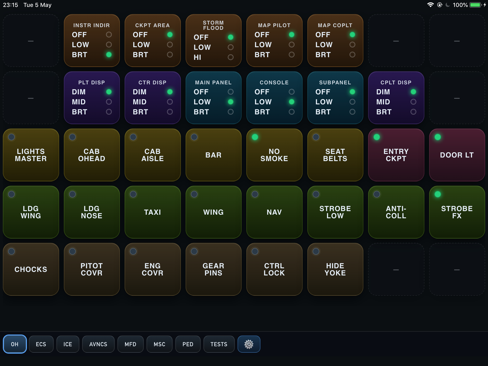
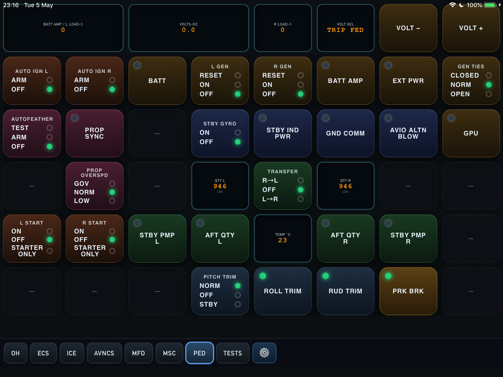
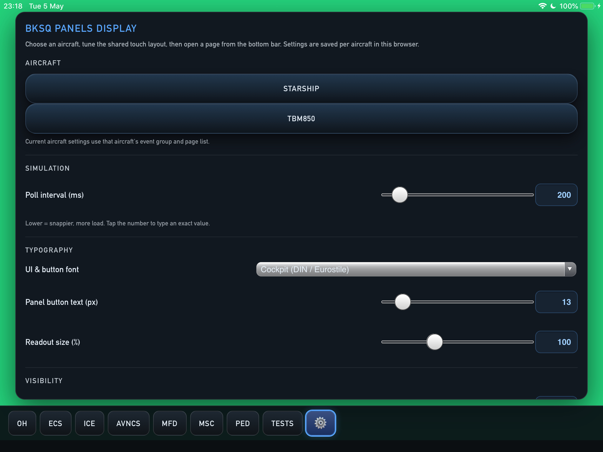
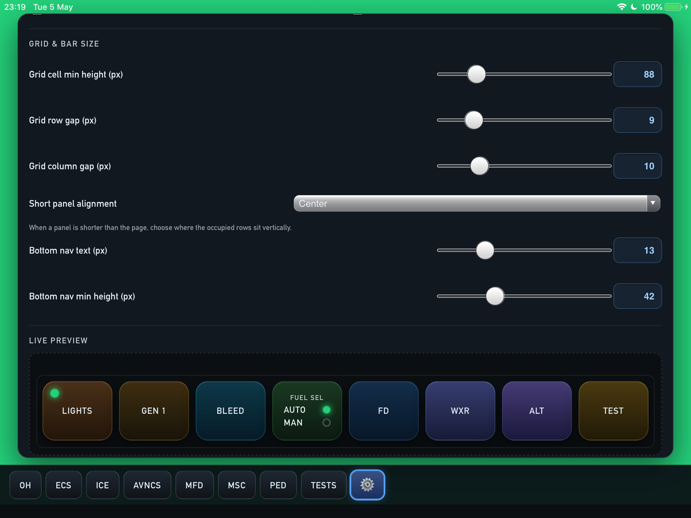
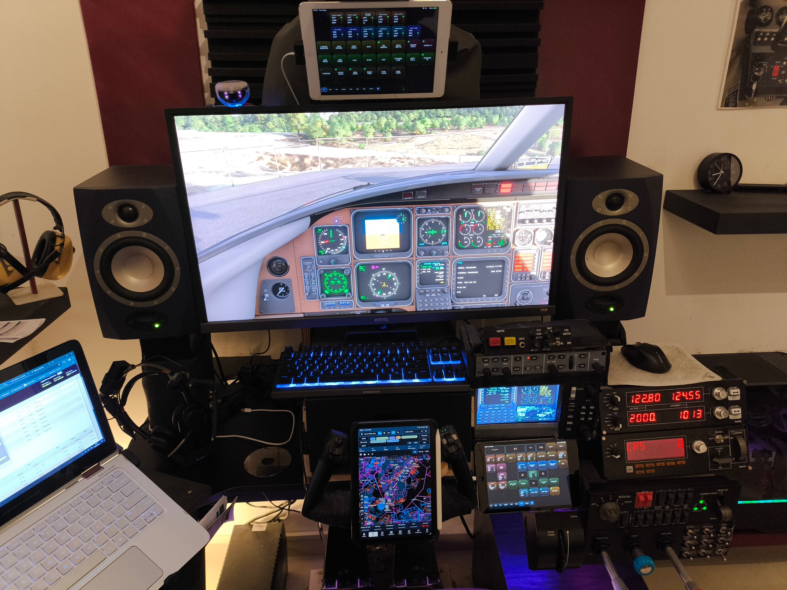

# BlackSquare AAO web panels

Touch-panel pages for **Black Square** aircraft in **AxisAndOhs (AAO)**. Use them on a phone, tablet, or second monitor while MSFS is running. Tested on iPad Air 1 and iPad mini 2 (iOS 12.5).

**Supported aircraft:** Beechcraft Starship, TBM 850

**Highlights**

- Large touch buttons with live lamps and readouts, tuned for old iPads (iOS 12.5).
- **EDIT** in the bottom bar: rearrange, add and remove buttons on the device by drag and drop, with a quick in-place button picker, undo, and JSON import/export.
- **⌂ auto-home**: return to a chosen page after a configurable idle time.
- Per-aircraft display settings (text size, brightness, grid spacing, poll rate, nav tabs).

## Screenshots

### Starship panels
&nbsp;&nbsp;&nbsp;&nbsp;&nbsp;

### Settings
&nbsp;&nbsp;&nbsp;&nbsp;&nbsp;

### SimPit example


---

## Quick start

1. Copy the whole `bksq-panels` folder into AAO web content (same area as the stock AAO panel template), e.g. `Documents\AAO\WebContent\bksq-panels\`.
2. In AAO **Script List → Import**, add the XML for your aircraft:
   - Starship: `aircraft/starship/bksq-starship-scripts.xml`
   - TBM 850: `aircraft/tbm850/bksq-tbm850-scripts.xml`
3. Open `http://localhost:<AAO_PORT>/bksq-panels/index.html` (port is often `8888`). MSFS and AAO must be connected for buttons to work.

On a tablet on the same Wi‑Fi, use `http://<PC_IP>:<AAO_PORT>/bksq-panels/index.html`. On iOS, **Add to Home Screen** for full-screen use.

---

## Documentation

| Audience | Document |
|----------|----------|
| Pilots / layout editors | [docs/USER-GUIDE.md](docs/USER-GUIDE.md) — install, navigation, settings, edit mode |
| Authors / contributors | [docs/DEVELOPER-GUIDE.md](docs/DEVELOPER-GUIDE.md) — architecture, buttons, polls, tools |
| AI coding agents | [AGENTS.md](AGENTS.md) and [docs/ai/](docs/ai/) |
| Layout review | [docs/LAYOUT-AUDIT.md](docs/LAYOUT-AUDIT.md) — per-page findings (regenerate with `node tools/audit-layouts.js`) |

**Aircraft notes:** [aircraft/starship/README.md](aircraft/starship/README.md), [aircraft/tbm850/README.md](aircraft/tbm850/README.md)

---

## Verification (optional)

```text
node tools/check-es5.js
node tools/audit-layouts.js
node aircraft/tbm850/tools/check-manifest.js
node aircraft/starship/tools/check-manifest.js
```

---

## License

See [LICENSE](LICENSE).
