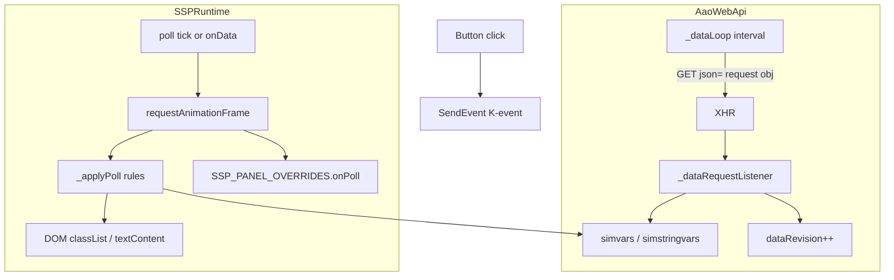

# Architecture (AI reference)

This describes the shipped v0.x engine. A vendor-neutral successor, **PanelKit**, is designed in [docs/design/panelkit/](../design/panelkit/README.md) and will be built next to this engine (nothing here changes until its switch-over work package is approved).

## Layers

```
┌─────────────────────────────────────────┐
│  pages/*.html — shell, nav, script tags │
├─────────────────────────────────────────┤
│  aircraft/*/config — buttons, panels    │
│  aircraft/*/panels/overrides.js         │
├─────────────────────────────────────────┤
│  common/panel-builder.js — layout→HTML  │
│  common/panel-runtime.js — boot, polls  │
│  common/panel-settings.js — UI prefs    │
│  common/panel-nav.js — ⌂ / EDIT in nav  │
│  common/panel-edit.js — layout editor   │
│  common/common.js — send*, get*, fitGrid│
├─────────────────────────────────────────┤
│  common/AaoWebApi.js — XHR poll loop    │
└─────────────────────────────────────────┘
         ↕ HTTP JSON to AAO
```

## Boot sequence (panel page)

1. `AaoWebApi` constructed; `StartAPI(pollMs)` begins `_dataLoop` interval.
2. `BKSQ_AIRCRAFT` meta loaded from `aircraft.js`.
3. `panel-settings.js` loads `localStorage`, sets CSS vars, may restart AAO interval.
4. `common.js` defines `sendP`, `getLVar`, `getAVar`, touch flash.
5. Aircraft `common.js` may alias senders.
6. `buttons.js` + `config/panels/<page>.js` populate `SSP_PANELS[pageId]`.
7. `SSPRuntime.boot(pageId)` calls `SSP_LAYOUT_STORE.mergePanel(pageId, panel)` (saved layout, skipped for `layoutEditDisabled`), renders the grid, applies `cols` inline, binds poll element handles, starts the render poll timer (also driven by AAO `onData`).
8. `boot` calls `SSP_NAV_TOOLS.mount(pageId, panel)` (`panel-nav.js`): inserts ⌂ and EDIT before the gear, records `<storageKey>:last-page`, starts the auto-home idle timer when a home page other than this one is set.
9. `SSPRuntime.enterEditMode()` lazy-loads `panel-edit.js` (EDIT button or `?edit=1`). Drag and drop uses touch + mouse events; iOS 12.5 has no Pointer Events or touch HTML5 DnD.

## Boot sequence (hub, `index.html`)

1. Inline script picks the aircraft (`?aircraft=` or `bksq-panels-last-aircraft`) and `document.write`s its `aircraft.js`.
2. `panel-settings.js` loads settings and binds the settings form (including Auto-home).
3. Two nav bars (settings overlay + main) are written from `pages[]`.
4. `panel-nav.js` → `SSP_NAV_TOOLS.mountHub()` adds the same ⌂ / EDIT buttons to both bars so the bar is identical to panel pages. Hub ⌂ scrolls to the Auto-home settings; hub EDIT opens the last page (skipping `noEdit` pages) with `?edit=1`; the last page's tab gets `.nav-last`.

## Data flow



**Registration:** `GetSimVar('(L:name, Type)')` or `(A:expr)` adds the var to `mainLoopRequestObj` on first access; subsequent reads return cached values until the next successful GET response updates them.

## Module ownership

| Module | Owns |
|--------|------|
| `AaoWebApi.js` | Network serialization, in-flight guard, URL cache, adaptive interval, `dataRevision` |
| `panel-runtime.js` | Render modes, poll kinds, `lampMaps`, RAF coalescing, element handle cache, `everyMs` |
| `panel-builder.js` | Token→HTML, `SSPPanel`, `SSP_PANEL_FACTORY`, `cols` passthrough |
| `panel-settings.js` | Settings schema and storage, CSS custom properties, AAO interval sync, hub settings form |
| `panel-nav.js` | Nav tools (⌂ / EDIT), auto-home idle timer, last-page record |
| `panel-edit.js` | Edit-mode UI and state: drag and drop, Move/Delete modes, picker, undo, JSON sheet, layout save |
| `overrides.js` (per aircraft) | Complex polls, lazy fallback var registration |

## Render modes

- `innerHtml` — default; concatenated button HTML from layout tokens.
- `rows` / `cells` — structured cells for MFD-style pages (Starship).

## Grid sizing

- Authoritative column count: panel spec `cols` (default 8) applied as inline `grid-template-columns` at boot.
- `fitGrid()` scales the grid with CSS `transform` when content exceeds viewport (unless scrollable mode).

## Edit mode

- Entered from the nav EDIT button or `?edit=1`; `panel-edit.js` is lazy-loaded.
- Works on the token list (`panel.sourceLayout` or the saved override), rebuilding `innerHtml` + polls through `SSPPanel` after each change, then re-binding poll handles.
- Every change is saved immediately to `<storageKey>:layout:<pageId>` and merged at the next boot. Undo is in memory (40 steps, current page only).
- A capture-phase `click` blocker on grid cells stops inline sim `onclick`s while editing.
- The dock sits at the top (`--ssp-edit-dock-h` pads `main`; `fitGrid` subtracts it) so the bottom nav, with EDIT → DONE, stays reachable.
- JSON sheet: `bksq-layout` (one page) and `bksq-layouts` (all saved pages) formats, plus a read-only config snippet. Formats are documented in `docs/DEVELOPER-GUIDE.md`.

## CSS-positioned pages (no grid edit)

- Starship `antiice` (`ice-grid`, `p-*` placement).
- Starship `mfd` (`mfd-shell`).

Flag with `layoutEditDisabled: true` on the panel spec and `noEdit: true` on the `aircraft.js` page entry. Edit mode refuses these pages and `mergePanel` never applies saved layouts to them.
