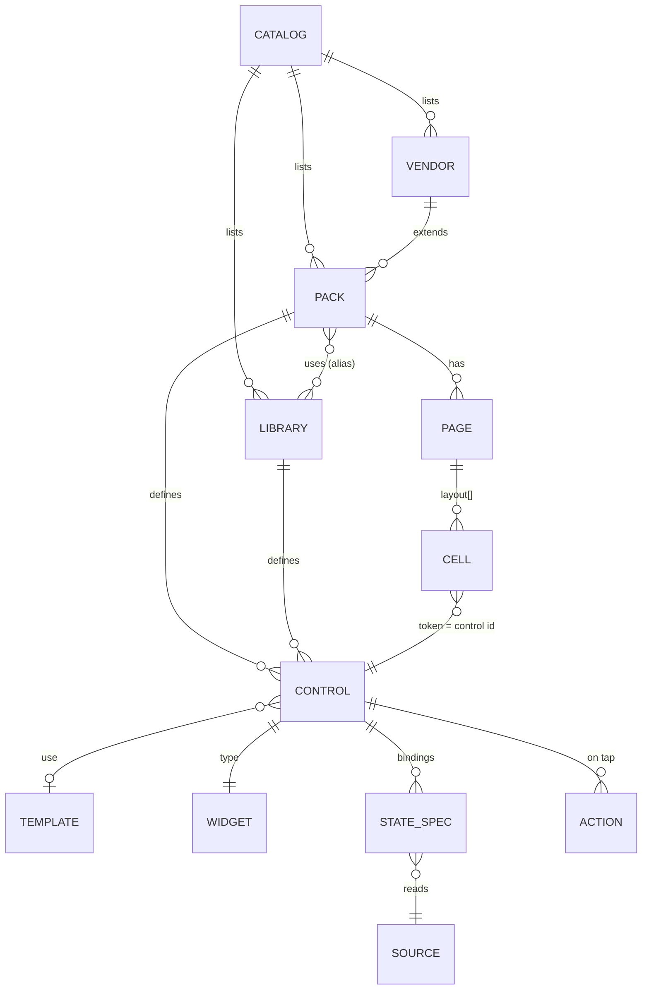
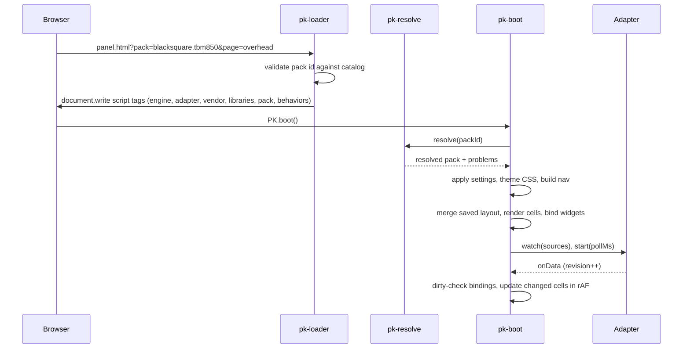

# PanelKit — high-level design

## 1. Context and problem

The v0.3 engine works well for two Black Square aircraft, but adding a third aircraft, or another vendor, means copying a folder and editing a dozen files by hand. Concretely:

| Pain point in v0.3 | Where | Effect |
|--------------------|-------|--------|
| One hand-written HTML file per page, each with its own copy of the nav bar and script list | `aircraft/*/pages/*.html` | Nav and boot order drift; 11 files to touch for a nav change |
| Buttons are raw HTML strings with inline `onclick` and hand-picked DOM ids | `config/buttons.js` | Duplicate ids silently break lamps; the edit-mode picker has to strip ids and handlers from markup |
| Multi-position switches, steppers and optimistic visuals are imperative code per aircraft | `panels/overrides.js`, `tbm850/common.js` (~800 lines) | Every new aircraft re-implements the same patterns |
| Lamp maps (raw value → lamp index) are functions inside the engine | `SSPRuntime.lampMaps` | Aircraft data leaks into engine code |
| AxisAndOhs, `SSP_` labels, `bksq-*` event groups and storage keys are hard-wired | `common.js`, `aircraft.js` | No other bridge, vendor or naming scheme without forking |
| Every poll rule re-applies DOM classes every tick | `panel-runtime.js` | Work on old iPads even when nothing changed |
| AAO script XML and JS labels are maintained separately and cross-checked afterwards | `bksq-*-scripts.xml`, `check-manifest.js` | Drift is caught late, not prevented |

## 2. Goals

| Id | Goal | Measured by |
|----|------|-------------|
| G1 | A typical aircraft is **data only**: no HTML, no DOM ids, no JS | TBM 850 pack needs no behaviors; Starship at most two (ECS temperature readouts, plus one spare for pedestal logic found during migration) |
| G2 | **Vendor reuse**: conventions, theme, templates and control sets are shared across a vendor's aircraft | A second Black Square aircraft reuses the vendor profile with zero copied templates |
| G3 | **Sim-agnostic** core: the simulator bridge is a pluggable adapter | Engine has no reference to `webApi`, `SendEvent` or RPN outside `adapters/` |
| G4 | **Same pilot features** as v0.3, generic: nav bar, settings, auto-home, edit mode with picker and JSON, hub | Feature parity checklist in [MIGRATION.md](MIGRATION.md) §7 |
| G5 | **Faster on iPad mini 2** than v0.3 | No DOM writes on ticks where no bound value changed; boot ≤ v0.3 on the same page |
| G6 | **Fail early**: authors get precise errors before a pilot sees a blank button | `tools/pk-validate.js` with rule ids; dev overlay in the browser |
| G7 | **User data survives** the migration | Saved settings and layouts from v0.3 load unchanged |
| G8 | **Implementable by lower-tier agents** | Each work package is small, has exact files, APIs and testable acceptance criteria |

## 3. Non-goals

- Rendering cockpit graphics (PFD/MFD glass, gauges with needles). Readouts are text.
- A visual pack editor. Authors edit `pack.js`; pilots customise layouts with edit mode.
- Supporting browsers older than iOS 12.5 Safari, or requiring anything newer.
- Runtime module bundling, npm dependencies, or a build step to *run* the panels.
- Networked multi-device sync of layouts (JSON export/import covers sharing).

## 4. Constraints

| Id | Constraint | Consequence |
|----|------------|-------------|
| C1 | iOS 12.5 Safari on A7 iPads | ES5 only; no Pointer Events, no HTML5 DnD on touch, no flexbox `gap`, no `fetch` reliance, no ES modules |
| C2 | Served as static files (AxisAndOhs web server or any static server); also openable from `file://` for desktop dev | Synchronous `<script>` loading; no server-side code |
| C3 | AxisAndOhs HTTP API: reads register vars on first `GetSimVar`; actions are K-events, RPN scripts | Adapter must register lazily and avoid registering fallbacks every tick |
| C4 | Tools run on plain Node (no `npm install`) | Hand-written validator and test runner |
| C5 | Repository rules in `AGENTS.md` (docs updated in the same change, ES5 check, don't rearrange shipped layouts) | Apply to every work package |

## 5. Architecture overview

```
┌──────────────────────────────────────────────────────────────────────┐
│ DATA (authored)                                                        │
│  packs/catalog.js   vendor.js   library .js   <aircraft>/pack.js       │
│                                               <aircraft>/behaviors.js  │
├──────────────────────────────────────────────────────────────────────┤
│ SHELLS            hub.html (→ index.html)     panel.html?pack=&page=   │
├──────────────────────────────────────────────────────────────────────┤
│ ENGINE  panelkit/                                                      │
│  core/     pk-core (namespace, registries, events, util)               │
│            pk-expr (source/action grammar)  pk-transform (values)      │
│            pk-resolve (merge + normalise + problems)  pk-store         │
│  runtime/  pk-boot  pk-layout  pk-widgets  pk-bind  pk-actions         │
│            pk-input                                                    │
│  chrome/   pk-nav  pk-settings  pk-autohome  pk-status  pk-edit (lazy) │
├──────────────────────────────────────────────────────────────────────┤
│ ADAPTERS   pk-adapter-aao (wraps common/AaoWebApi.js)  pk-adapter-mock │
└──────────────────────────────────────────────────────────────────────┘
          ↕ HTTP JSON (AxisAndOhs)            ↕ in-memory (tests, desktop)
```

**Dependency rule:** arrows only point down. `core/` depends on nothing but itself. `runtime/` and `chrome/` depend on `core/` and talk to the simulator only through the adapter interface. Packs never call engine internals; behaviors use only the documented `api` object passed to them.

## 6. Data model



A **control** is the unit pilots place and authors define:

```javascript
lts_master: {
  type: 'toggle',
  label: 'LIGHTS MASTER',
  group: 'lts',
  action: 'script:SSP_OH_LIGHTS_MASTER_TOGGLE',
  state: 'L:var_MasterPanelLights,Bool'
}
```

The engine generates all markup and element references from this. Full format: [PACK-FORMAT.md](PACK-FORMAT.md).

**Precedence** (later wins): engine defaults → vendor profile → libraries (in `uses` order) → pack → pilot's saved settings and layouts.

## 7. Runtime flow

### 7.1 Opening a panel page



### 7.2 Tap

`pk-input` catches the touch on a cell part → confirm guard (if configured) → `PK.actions.run(action, ctx)` → adapter `run()` for sim actions, or the engine for `local:` variables and behaviors → the next data revision updates the cell. Optimistic widgets show the expected state immediately and reconcile when data arrives.

### 7.3 Edit mode

Unchanged in concept from v0.3: EDIT in the nav lazy-loads `pk-edit.js`; the page's layout is a list of control ids; every change re-renders through the same layout code and saves to `<storageKey>:layout:<pageId>`. The picker renders inert previews by calling widgets with `inert: true` instead of stripping markup.

## 8. Extension points

| Extension | Who | How | Spec |
|-----------|-----|-----|------|
| New aircraft | Pack author | `packs/<vendor>/<aircraft>/pack.js` + catalog entry | [AUTHORING-GUIDE.md](AUTHORING-GUIDE.md) |
| New vendor | Vendor author | `packs/<vendor>/vendor.js` + catalog entry | [PACK-FORMAT.md](PACK-FORMAT.md) §4 |
| Shared control set | Vendor author | `PK.defineLibrary` file, included with `uses` | [PACK-FORMAT.md](PACK-FORMAT.md) §5 |
| Look and feel | Vendor / pack author | `theme.vars`, `theme.groups` | [PACK-FORMAT.md](PACK-FORMAT.md) §10 |
| Value mapping | Pack author | named `maps` and `formats` | [PACK-FORMAT.md](PACK-FORMAT.md) §8–§9 |
| One-off logic | Pack author | `PK.defineBehavior` in `behaviors.js` | [WIDGETS.md](WIDGETS.md) §12 |
| New control type | Engine developer | `PK.widgets.define` | [WIDGETS.md](WIDGETS.md) §13 |
| New simulator bridge | Engine developer | `PK.adapters.define` | [ADAPTERS.md](ADAPTERS.md) |

## 9. Customization levels

| Level | Person | Tool | Example |
|-------|--------|------|---------|
| 1 | Pilot | Edit mode, settings, JSON import | Move the parking brake to the overhead page |
| 2 | Pack author | `pack.js` data | Add the Kodiak's fuel pump switch |
| 3 | Vendor | `vendor.js`, libraries | Black Square colour palette, `bksq-<aircraft>-panel` script group |
| 4 | Engine developer | Widgets, adapters | A `slider` widget, a WebSocket adapter |

Each level MUST be reachable without touching the levels below it.

## 10. Performance design

| Area | v0.3 | PanelKit |
|------|------|----------|
| Network | One in-flight GET, adaptive interval (keep) | Same, inside the AAO adapter |
| Per tick | Every poll rule re-applies classes | Read each watched var once; only bindings whose var changed are evaluated; only changed outputs touch the DOM |
| DOM lookups | Cached per rule | Element refs collected once per cell at bind time; no ids |
| Rendering | One `innerHTML` per page | Same |
| Event handlers | Inline `onclick` per button | One delegated listener set on the grid |
| Slow readouts | `everyMs` | Same, per state spec |
| Edit mode | Lazy script | Same |
| Page switch | Full reload | Full reload (ADR-003); in-place switching is a later option |

Budget on iPad mini 2 (A7, iOS 12.5): a tick with no changes MUST cost no DOM writes; a tick with ≤ 10 changed values SHOULD finish in under 4 ms of script time.

## 11. Security and robustness

- The loader only loads files listed in the catalog. `?pack=` is an id looked up in the catalog, never a path (blocks `?pack=../../x`).
- Labels are plain text and always escaped. Packs cannot inject HTML; only widgets and behaviors produce markup.
- Imported layout JSON contains control ids only. Unknown ids become empty cells; nothing from the file is inserted as markup.
- Action dispatch and widget updates are wrapped so one failing control cannot stop the update loop; failures go to `PK.log` and the dev overlay.
- Behaviors are code shipped in the repository like the engine; they are reviewed like engine code.

## 12. Compatibility and migration

PanelKit is built **next to** the legacy engine (strangler pattern, ADR-010). Legacy files are not edited until the switch-over work package, which needs explicit user approval. Continuity:

- Packs for Starship and TBM keep their legacy `storageKey`, so saved settings carry over.
- Control ids equal legacy layout tokens, so saved layouts carry over.
- Old page URLs become redirects to `panel.html?pack=…&page=…`, preserving `?edit=1`.
- JSON import accepts the legacy `bksq-layout` / `bksq-layouts` formats.

Details: [MIGRATION.md](MIGRATION.md).

## 13. Risks

| Risk | Likelihood | Mitigation |
|------|-----------|------------|
| `document.write` loading is deprecated in modern browsers | Low (still works in Safari and Chrome for same-origin, parser-inserted scripts) | Loader isolated in one file; fallback path documented in ADR-002 |
| Declarative format cannot express a legacy control | Medium | Behaviors escape hatch; migration lists every imperative handler and its target form |
| Dirty-checking misses time-based state (hold latches, `everyMs`) | Medium | Engine timers invalidate bindings explicitly; tests cover latches |
| Lower-tier agents drift from the spec | Medium | Small work packages, rule ids, acceptance tests, reviewer checklist |
| iOS 12 touch quirks (ghost clicks, scroll vs tap) | Medium | Single input module with the rules in DETAILED-DESIGN §9 and a device test checklist |

## 14. Phasing

| Phase | Outcome | Work packages |
|-------|---------|---------------|
| 0 | Test runner, ES5 check covers new folders | WP-00, WP-01 |
| 1 | Core: grammar, transforms, resolver, validator | WP-02 … WP-06 |
| 2 | Runtime: adapters, bindings, widgets, layout, input, loader | WP-07 … WP-13 |
| 3 | Chrome: nav, settings, auto-home, status, edit mode, hub | WP-14 … WP-19 |
| 4 | Author tooling: XML generator, scaffolder, legacy importer, gallery | WP-20 … WP-23 |
| 5 | Migration: Black Square vendor, TBM, Starship, custom pages, switch-over | WP-24 … WP-29 |

Each phase ends with every verification command green and the docs current.
